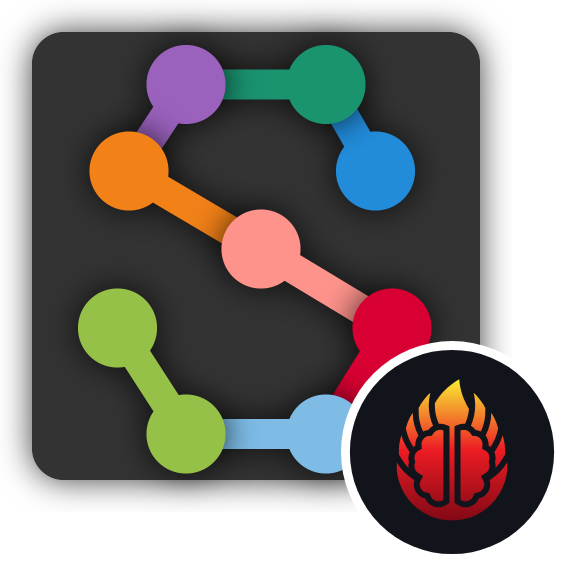

  
  <h1 align="center">EMBER SLEAP</h1>
  

    
    
    
  

Label, train and predict using [SLEAP](https://sleap.ai) directly on data in the [EMBER archive](https://dandi.emberarchive.org).
Able to leverage cloud resources for all compute steps and backs up all operations and provenance to the archive.

---

[SLEAP Web App](https://app.sleap.ai) created and maintained by the [Talmo Lab](https://talmolab.org/).

Webkit wrapper and EMBER integration maintained by the [Center for Open Neuroscience](https://centerforopenneuroscience.org).

Funded by the [National Institutes of Health (NIH)](https://www.nih.gov/brain/research/data-knowledge-resources) grant [R24 MH136632](https://reporter.nih.gov/search/kDbcoCvju0ymZz0fI3zvhA/project-details/10888659) as a part of the [Brain Behavior Quantification and Synchronization (BBQS)](https://brain-bbqs.org/) consortium.

## Status: prototype

This is the ember-sleap side of [the development plan](docs/DEVELOPMENT_PLAN.md).
So far the page is the BBQS shell around where the SLEAP web app will mount: the header, led by SLEAP's logo with an EMBER badge, an empty area filling the window, and the footer, dark only like the SLEAP app.

Local development is in [docs/README.md](docs/README.md).
